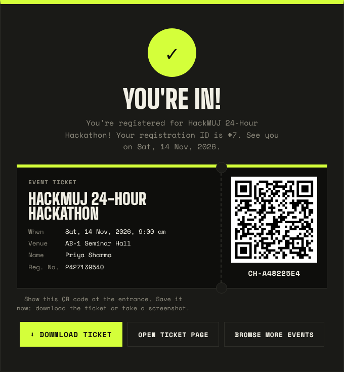

# Campus Event Hub

A single place for MUJ students to browse club events and register for them.
Built with **HTML, CSS, JavaScript and JSON**, with **PHP + MySQL** for saving registrations.

**Web Technology Mini Project** · Raghav Malhotra · B.Tech CSE (AI & ML) · Reg. No. 2427010321 · Manipal University Jaipur

**▶ Live demo: [raghazzz.github.io/campus-event-hub](https://raghazzz.github.io/campus-event-hub/)**
The live demo runs without a server, so it opens in **demo mode**: browsing, search, countdowns, registration and the admin view all work, but registrations are saved in your browser only. For the full version with PHP + MySQL, run it locally (below).


| Event details | Registration | QR ticket |
|---|---|---|
|  |  |  |

| Admin dashboard with door check-in |
|---|
|  |

## Features
- Event listing loaded from `data/events.json` with `fetch()`
- Live search, category chips, club filter, upcoming/past filter
- Live countdown timer on every event (updates every second, e.g. T-12D 04:30:05)
- Seats-left progress bar (counts come from MySQL)
- Event details page with a large countdown and a copy-link button
- Registration form with live JavaScript validation, sent to the server as JSON
- Server-side validation, duplicate check and capacity check in PHP
- Admin login (hashed passwords, PHP sessions)
- Admin dashboard: stats, search, filter by event, delete, export to CSV
- **QR tickets:** every registration gets a unique ticket code (e.g. `CH-7F3A9C21`) shown as a QR code, with a *Download ticket* button that saves it as a PNG
- **Door check-in:** the admin scans the QR with the laptop camera (`getUserMedia` + jsQR) or types the code; the ticket is marked as used in MySQL, and a second scan shows "already checked in"
- **Ticket page:** scanning a QR with any phone opens `ticket.html`, which shows whether the ticket is valid or already used
- "Ticket Booth" design: dark by default with a Light button for dim projectors (saved in `localStorage`), scrolling event ticker, ticket-shaped cards, fully responsive

## Folder structure
```
campus-event-hub/
├── index.html        Home page: all events
├── event.html        One event's details
├── register.html     Registration form
├── admin.html        Admin login + dashboard + door check-in
├── ticket.html       Ticket check page (what a scanned QR opens)
├── css/style.css     All styles (light + dark theme)
├── js/
│   ├── common.js     Shared helpers: fetch, dates, countdown, theme, demo mode
│   ├── home.js       Listing, search and filters
│   ├── event.js      Event details + countdown
│   ├── register.js   Form validation + submit + QR ticket
│   ├── ticket.js     Looks up a ticket and shows valid / used
│   ├── admin.js      Dashboard, delete, CSV export, QR check-in
│   └── vendor/       qrcode.js (makes QR codes) and jsQR.js (reads them from the camera)
├── data/
│   ├── events.json   Event data
│   ├── clubs.json    Club data (each club has its own accent colour)
│   └── fallback.js   Offline copy of the data, used in demo mode
├── api/
│   ├── config.php        DB connection + helpers
│   ├── register.php      POST: save a registration
│   ├── counts.php        GET: registrations per event
│   ├── auth.php          Admin login / logout / status
│   ├── ticket.php        GET: check a ticket · POST: check in (admin only)
│   └── registrations.php GET list, DELETE one (admin only)
├── database.sql      Creates the database, tables and a default admin
├── Dockerfile + docker-compose.yml   Run everything with one command
└── tools/build_fallback.py          Refreshes data/fallback.js after editing events.json
```

## How to run (Docker — easiest on a Mac)
1. Open **Docker Desktop** and wait until it says it's running.
2. In Terminal, go to this folder and start everything:
   ```bash
   cd ~/Desktop/campus-event-hub
   docker compose up -d
   ```
   The first run downloads PHP, MariaDB and phpMyAdmin (a few minutes). The database and default admin are created automatically from `database.sql`.
3. Open **http://localhost:8080**. phpMyAdmin is at **http://localhost:8081** (user `root`, password `campushub`).
4. To stop: `docker compose down`. Registrations are kept for next time. To wipe the database and start fresh: `docker compose down -v`.

## How to run (XAMPP)
1. Install XAMPP and open the **XAMPP Control Panel**. Start **Apache** and **MySQL**.
2. Copy the `campus-event-hub` folder into `C:\xampp\htdocs\` (on macOS, `/Applications/XAMPP/htdocs/`).
3. Open **http://localhost/phpmyadmin**, go to the **Import** tab, choose `database.sql` and click **Go**.
4. Open **http://localhost/campus-event-hub/** in your browser.

Admin login: **username `admin`, password `admin123`**.

> Open the site through `http://localhost/...` for the full version. Double-clicking `index.html` also works, but in demo mode (see below).

**Already have the database from an older version?** No need to re-import: the first API request adds the new ticket columns and gives existing registrations a ticket code automatically (`ensureSchema()` in `api/config.php`).

If your MySQL root user has a password, set it in `api/config.php`.

## Libraries
Two small open-source libraries are bundled in `js/vendor/` so the site also works offline: [qrcode-generator](https://github.com/kazuhikoarase/qrcode-generator) (MIT) to draw QR codes, and [jsQR](https://github.com/cozmo/jsQR) (Apache 2.0) to read them from the camera. Everything else is written from scratch.

## Adding a new event
Add an object to `data/events.json` with a new `id`, then run `python3 tools/build_fallback.py` so the offline copy in `data/fallback.js` matches, and refresh the page. No database change is needed.

## Demo mode (no server)
When the page can't reach PHP (opened by double-clicking `index.html`, or hosted on GitHub Pages), `hasBackend()` in `js/common.js` detects it and the site switches to demo mode:
- Event and club data come from `data/fallback.js` instead of `fetch()`
- Registrations use the same validation, duplicate and capacity rules, but are stored in `localStorage`
- QR tickets and check-in work the same way, using the tickets saved in that browser
- The admin dashboard shows the sample rows plus browser-saved ones (demo login `admin` / `admin123`)
- A banner under the navbar makes it clear that this is the demo

With PHP + MySQL running, none of this is used and everything goes through the API.

## How data flows
```
Browser (HTML/CSS/JS)
   │  fetch('data/events.json')         → event and club info (JSON)
   │  fetch('api/counts.php')           → seats taken (JSON from MySQL)
   │  POST JSON to 'api/register.php'   → PHP validates → INSERT into MySQL → returns ticket code
   │  qrcode.js draws the ticket QR     → link to ticket.html?code=CH-XXXXXXXX
   │  camera → jsQR → 'api/ticket.php'  → checks the code → UPDATE checked_in_at
   ▼
PHP (api/*.php) ──► MySQL (registrations, admins)
```
